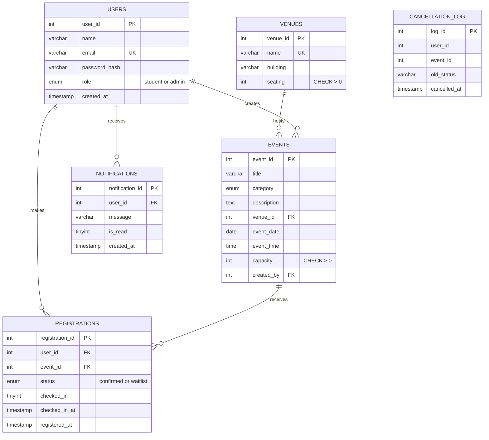

# Database design

## ER diagram
Image for your report: `docs/er-diagram.png`. The same diagram as Mermaid (GitHub renders it):

`cancellation_log` has no foreign keys on purpose: it is an audit trail that must outlive deleted users and events.

## Relational schema
- `users(user_id PK, name, email UNIQUE, password_hash, role, created_at)`
- `venues(venue_id PK, name UNIQUE, building, seating)`
- `events(event_id PK, title, category, description, venue_id FK→venues, event_date, event_time, capacity, created_by FK→users)`
- `registrations(registration_id PK, user_id FK→users, event_id FK→events, status, checked_in, checked_in_at, registered_at, UNIQUE(user_id, event_id))`
- `notifications(notification_id PK, user_id FK→users, message, is_read, created_at)`
- `cancellation_log(log_id PK, user_id, event_id, old_status, cancelled_at)`

Normalisation: every non-key attribute depends only on its table's key (3NF). Venue details live in `venues` instead of being repeated on every event. The many-to-many relation between users and events is resolved by `registrations`.

## Constraints
| Constraint | Where | Why |
|---|---|---|
| PRIMARY KEY | all tables | unique row identity |
| UNIQUE (email), UNIQUE (venue name) | users, venues | no duplicates |
| UNIQUE (user_id, event_id) | registrations | no double registration |
| FOREIGN KEY ... ON DELETE CASCADE | registrations, notifications | deleting a user or event removes dependent rows |
| FOREIGN KEY ... ON DELETE RESTRICT | events.venue_id | a venue in use cannot be deleted |
| FOREIGN KEY ... ON DELETE SET NULL | events.created_by | events outlive the admin who made them |
| CHECK (capacity > 0), CHECK (seating > 0) | events, venues | no zero or negative sizes |
| ENUM | role, category, status | only valid values |
| NOT NULL | required columns | no missing data |

## Indexes
`idx_event_date`, `idx_event_category`, `idx_notif_user (user_id, is_read)`, FULLTEXT `ft_events(title, description)`, and `idx_reg_event_status` (added with ALTER).

## Five core advanced database concepts (Stage 3 asks for four)
| # | Concept | Implementation | Evidence |
|---|---|---|---|
| 1 | Transactions | `register_for_event` and `cancel_registration` use START TRANSACTION, `FOR UPDATE` row locks and a ROLLBACK handler; a manual ROLLBACK demo | `database/evidence.sql` section 1 |
| 2 | Views | `event_fill`, `v_registration_details` | section 2 |
| 3 | Stored procedures and functions | 2 procedures and `fn_seats_left` | section 3 |
| 4 | Triggers | 6 triggers (validation, audit, notifications) | section 4 |
| 5 | Indexing and full-text search | B-tree indexes, FULLTEXT `ft_events`, `EXPLAIN` | section 5 |

Extras beyond the five: `WITH ROLLUP` and window functions (Reports tab), and MongoDB for reviews and activity.

## Details of every advanced feature
1. **Transactions**: `register_for_event` and `cancel_registration` use START TRANSACTION, row locking and ROLLBACK on error.
2. **Views**: `event_fill`, `v_registration_details` (4-table join).
3. **Stored procedures**: `register_for_event`, `cancel_registration`.
4. **Function**: `fn_seats_left`.
5. **Triggers (6)**: `block_past_events`, `log_cancel`, `check_venue_capacity`, `protect_capacity`, `notify_registration`, `notify_promotion`.
6. **Indexing**: B-tree indexes plus `EXPLAIN` evidence in `queries.sql`.
7. **Full-text search**: `MATCH ... AGAINST` behind the search box.
8. **Analytic SQL**: `WITH ROLLUP` and window functions `RANK() OVER (PARTITION BY ...)` in the Reports tab.

## Why MongoDB as well
Reviews and the activity feed are document-shaped and write-heavy, and they don't need joins or strict schemas.
- `reviews`: `{ eventId, userId, userName, rating, comment, createdAt }`. Operations: `updateOne` with upsert (one review per user per event), `find` with sort, and an `aggregate` with `$match` and `$group` for the average rating.
- `activity`: `{ userId, userName, action, eventId, at }`. Operations: `insertOne` on each register or cancel, and `find` with sort and limit for the admin Dashboard and Audit log tabs.

MySQL keeps the data that needs integrity (users, venues, events, seats). MongoDB keeps the flexible data. The two are linked: only a user with a *confirmed* MySQL registration can write a MongoDB review.

## Application tabs
| Tab | Who | What it shows | Database features used |
|---|---|---|---|
| Events | everyone | search and category filter, seat bars | FULLTEXT, view, function |
| Event detail | everyone | register, waitlist, reviews | procedure, transaction, MongoDB |
| Calendar | everyone | events grouped by month and day | joins |
| My tickets | student | registrations, waitlist, check-in status | joins |
| Notifications | student | messages created by triggers | triggers |
| Profile | student | edit name, change password | UPDATE, hashing |
| Admin → Dashboard | admin | totals, category table, hot events, activity | GROUP BY/HAVING, correlated subquery, MongoDB |
| Admin → Events | admin | add, edit capacity, delete | INSERT/UPDATE/DELETE, triggers |
| Admin → Attendees | admin | registration list with check-in | 4-table join, UPDATE |
| Admin → Venues | admin | add, edit seating, delete | RESTRICT, constraints |
| Admin → Users | admin | list, promote or demote | LEFT JOIN, GROUP BY, authorization |
| Admin → Reports | admin | rollup, rankings, daily counts | ROLLUP, window functions |
| Admin → Audit log | admin | cancellations and activity | trigger table, MongoDB |

## Security
- Passwords hashed with scrypt and a per-user salt, compared with `timingSafeEqual`.
- Login sets a signed JWT in an `httpOnly`, `sameSite=lax` cookie (2 hour expiry).
- Two roles. Every protected route is wrapped by `wrap(handler, role)`. Admin routes re-check the role in the database, so a demoted admin loses access at once.
- The acting user id always comes from the token, never from the request body.
- All SQL uses parameter placeholders (`?`). The one dynamic fragment (full-text terms) is stripped to `[a-z0-9]` first.
- Input validation on every route (`lib/validate.js`). React escapes rendered text, so stored reviews cannot inject scripts.
- Secrets live in `.env`, which is git-ignored. No third-party API keys are used.
